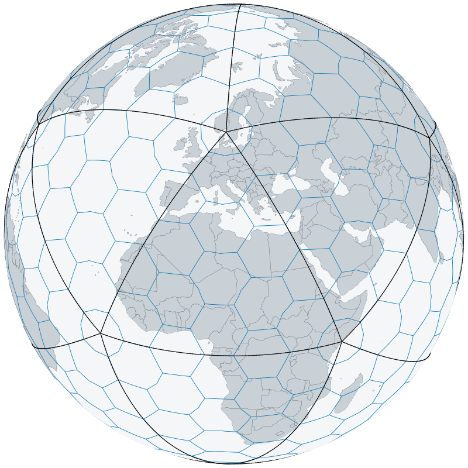

# hexglobe

*globes of hexagon grids drawn on the graphics card*

<!-- badges: start -->

[](https://opensource.org/licenses/MIT)
<!-- badges: end -->

hexglobe draws the interactive globes of
[hexify](https://gillescolling.com/hexify/), such as a hexagon grid over
the continents, as PNG images from R, with no browser.

A globe from `hexify::hex_globe()` is an HTML widget that draws itself
in the browser through WebGPU. hexglobe draws the same globe offscreen
on the graphics card through [wgpu](https://wgpu.rs), the Rust
implementation of WebGPU, with the widget’s own shader and pipelines,
and returns the image as pixels or a PNG file. hexify calls it from
`hex_globe_png()`, so you can save globes from a script or a report and
choose their size in pixels.

hexglobe supports:

- **Globes as PNG files.** `hexify::hex_globe_png()` renders a globe
  widget to a PNG file, and a globe takes a few hundredths of a second
  once the graphics device is open.
- **Vulkan, Direct3D 12 and Metal.** The renderer draws on whichever of
  these the machine has, and `gpu_adapter()` names the graphics card in
  use.
- **Images as data.** `render_scene()` returns the pixels as red, green,
  blue and alpha bytes, and `write_png()` and `read_png()` move them to
  and from PNG files.

The image matches the widget’s to within the anti-aliasing of edges,
because both run the same shader and pipelines.

## Installation

hexglobe compiles Rust code. Install the build tools for your operating
system first:

| Operating system | Build tools |
|----|----|
| Windows | [Rtools](https://cran.r-project.org/bin/windows/Rtools/) matching your R version |
| macOS | Run `xcode-select --install` in Terminal |
| Debian / Ubuntu | Install `r-base-dev` |
| All | Rust’s `cargo` and `rustc`, from [rustup](https://rustup.rs) |

On Windows, add the Rust target that R’s toolchain links against:

``` sh
rustup target add x86_64-pc-windows-gnu
```

Check that R can find the compiler:

``` r
pkgbuild::has_build_tools(debug = TRUE)
```

Then install hexglobe:

``` r
# install.packages("pak")
pak::pak("gcol33/hexglobe")
```

The build runs `cargo` to compile the Rust library with wgpu and its
other Rust dependencies. On macOS the package links against Apple’s
Metal, QuartzCore and CoreGraphics frameworks, and on Linux against the
dynamic loader and threads libraries.

## Usage

1.  Build a grid with `hexify::hex_grid()` and a globe widget with
    `hexify::hex_globe()`.
2.  Save the globe as a PNG file with `hexify::hex_globe_png()`, which
    draws it through hexglobe.
3.  Check which graphics card drew it with `gpu_adapter()`.

``` r
library(hexify)

grid <- hex_grid(resolution = 3, aperture = 3)
globe <- hex_globe(grid)
hex_globe_png(globe, "globe.png")
```

<p align="center">


</p>

The image is 800 by 800 pixels; the `width`, `height` and `scale`
arguments of `hex_globe_png()` set its size.

``` r
hexglobe::gpu_adapter()
#> [1] "NVIDIA GeForce RTX 5080 (Vulkan)"
```

The adapter is picked once per session, preferring a discrete graphics
card. The environment variables `WGPU_POWER_PREF` (`"low"` or `"high"`)
and `WGPU_BACKEND` (such as `"dx12"`, `"vulkan"` or `"metal"`), set
before the first globe is drawn, choose another.

## Documentation

- [Interactive
  Globe](https://gillescolling.com/hexify/articles/globe.html): the
  globe widget of hexify, which hexglobe draws offscreen.
- The help pages `?render_scene`, `?gpu_adapter`, `?write_png` and
  `?read_png` describe each function, including the layout of a scene.

## Getting help

Questions and bug reports go to the [GitHub
issues](https://github.com/gcol33/hexglobe/issues). A bug report is
easiest to act on with a small reproducible example, for instance made
with [reprex](https://reprex.tidyverse.org/), and the output of
`gpu_adapter()`.

## Support

> “Software is like sex: it’s better when it’s free.” — Linus Torvalds

I’m a PhD student who builds R packages in my free time because I
believe good tools should be free and open. I started these projects for
my own work and figured others might find them useful too.

If this package saved you some time, buying me a coffee is a nice way to
say thanks. It helps with my coffee addiction.

[](https://buymeacoffee.com/gcol33)

## Acknowledgements

The drawing runs on [wgpu](https://wgpu.rs), the Rust implementation of
WebGPU, and the scenes and the shader come from
[hexify](https://gillescolling.com/hexify/).

## License

hexglobe is licensed under MIT.

## Citation

``` text
Colling G (2026). _hexglobe: Render 'hexify' Globes on the Graphics
Card Without a Browser_. R package version 0.1.0,
<https://github.com/gcol33/hexglobe>.
```

BibTeX:

``` bibtex
@Manual{colling2026hexglobe,
  title = {hexglobe: Render 'hexify' Globes on the Graphics Card Without a Browser},
  author = {Gilles Colling},
  year = {2026},
  note = {R package version 0.1.0},
  url = {https://github.com/gcol33/hexglobe},
}
```
